# Tờ duyệt ảnh bìa R1-AI — VÒNG 2 (bộ Test & Compare mới)

Chủ dự án 17/10: rà khớp khán giả, một vòng sửa chữ (`ai/round2.py`, cùng bố cục và phép kiểm). Mỗi video: **3 ảnh = bộ Test & Compare**, #1 = đề nghị mặc định. Tập 2 và Tập 9 không đổi (bộ vòng 1 bên dưới). Kiểm 168×94: **15/15 ĐẠT**, claim-risk 0.

## Tập 5 · PMI — `1o-2RJ-DdfE` · T1: When Does PMI Go Away With 10% Down? 8 Years by Schedule

| TC | cỡ thật (bấm mở) | điện thoại 360 px | 168×94 | điểm Claude | kiểm máy · nền · claim |
|---|---|---|---|---|---|
| **#1** |  |  |  | 9: số khớp tiêu đề "8 Years"; khiên + đồng hồ cát | ĐẠT: "PMI FOR 8 YEARS?" · chữ 9.2/12.2 px · 15.88 / 7.17:1 · nền `ep005-a` · lịch luật: xin huỷ ở payment 99 ≈ 8 năm (lời 0:10 "about 8 years") — khớp tiêu đề T1 |
| **#2** |  |  |  | 9: như #1, đồng hồ cát rõ nhất ở 168 px | ĐẠT: "PMI FOR 8 YEARS?" · chữ 9.2/12.2 px · 17.12 / 9.9:1 · nền `ep005-d` · như trên |
| **#3** |  |  |  | 8.5: bản "23 MONTHS" giữ để đo lệch/khớp số với tiêu đề | ĐẠT: "ON PAPER? 23 MONTHS" · chữ 9.2/9.7 px · 11.52 / 7.24:1 · nền `ep005-a` · medianB_months_to80 — giữ 1 bản để đo |

## Tập 8 · rent vs buy — `26SfSIDPpzk` · T1: Is Renting a Waste of Money? Buying Led in 3 of 4 Months

| TC | cỡ thật (bấm mở) | điện thoại 360 px | 168×94 | điểm Claude | kiểm máy · nền · claim |
|---|---|---|---|---|---|
| **#1** | <a href="final/ep008-tc1.jpg">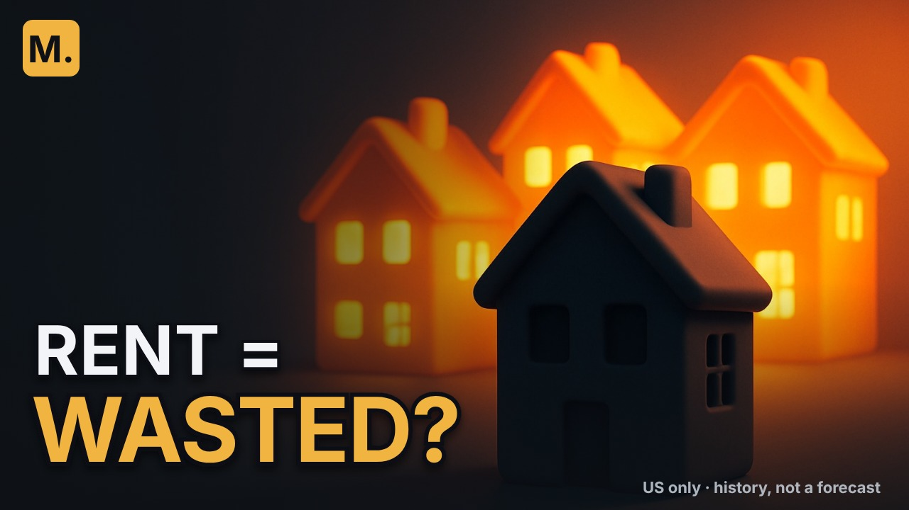</a> |  |  | 9: đúng câu hỏi tiêu đề; chữ màu lớn đọc ngay ở 168 px | ĐẠT: "RENT = WASTED?" · chữ 9.2/12.0 px · 16.43 / 8.5:1 · nền `ep008-b` · câu hỏi của Nina (0:26) = tiêu đề T1; chữ màu là chữ, không thêm số (75.6 % đứng một mình dễ đọc thành "75.6 % lãng phí") |
| **#2** |  |  |  | 8.5: bản cũ, có số — giữ để đo | ĐẠT: "WORST CASE -$82,385" · chữ 9.2/12.6 px · 5.82 / 8.45:1 · nền `ep008-b` · adv_2006-06 — giữ để đo |
| **#3** |  |  |  | 8: câu hỏi trên nền phố sáng/tối | ĐẠT: "RENT = WASTED?" · chữ 9.2/12.0 px · 13.22 / 8.2:1 · nền `ep008-a` · như dòng 1, nền phố |

## Tập 1 · refi — `OEVfD-ywzLc` · T1: Should I Refinance? A $115,000 Loan Needed a 1.12-Point Cut

| TC | cỡ thật (bấm mở) | điện thoại 360 px | 168×94 | điểm Claude | kiểm máy · nền · claim |
|---|---|---|---|---|---|
| **#1** |  |  |  | 8.5: vòng 3: số khớp tiêu đề T1 (1.12 điểm của Walt); đồng hồ = tháng hoàn phí | ĐẠT: "RATE DROP NEEDED: 1.12" · chữ 9.2/9.2 px · 16.99 / 10.2:1 · nền `ep001-c` · vòng 3 (chủ dự án 17/10): Walt $115,000 cần lãi giảm 1.12 điểm để hoàn phí trong 3 năm (lời 7:10) — khớp tiêu đề T1 |
| **#2** |  |  |  | 8: vòng 3: "worth it" = cụm tìm kiếm; $5,124 = hoá đơn của Nora, nền thư đề nghị (0:33); 5 từ > luật 4 từ (chữ chủ dự án chỉ định) | **TRƯỢT**: "WORTH IT? $5,124 IN FEES" · chữ 9.2/10.3 px · 6.79 / 6.2:1 · nền `ep001-a` · vòng 3: hoá đơn refi của Nora $5,124 (median HMDA 2025, lời 0:33); 5 từ — chữ chủ dự án chỉ định, vượt luật ≤ 4 từ |
| **#3** |  |  |  | 8: bản cũ — giữ để đo | ĐẠT: "FEES BACK? MONTH 30" · chữ 9.2/10.9 px · 8.29 / 10.2:1 · nền `ep001-c` · bản cũ — giữ để đo |

## Tập 7 · 15 vs 30 — `p78Ca1OHTgM` · T1: 15 Year vs 30 Year Mortgage Paid in 15: $120 a Month More

| TC | cỡ thật (bấm mở) | điện thoại 360 px | 168×94 | điểm Claude | kiểm máy · nền · claim |
|---|---|---|---|---|---|
| **#1** |  |  |  | 8.5: câu hỏi đúng lựa chọn; chồng vàng = khoản dự phòng | ĐẠT: "15 OR 30?" · chữ 12.4 px · 15.36:1 · nền `ep007-a` · số đã ở tiêu đề; câu hỏi của Tessa (0:11) |
| **#2** | <a href="final/ep007-tc2.jpg">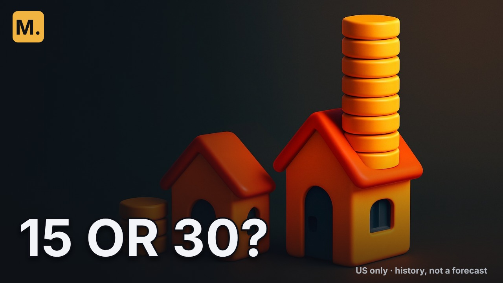</a> |  |  | 8: Leo vs Tessa | ĐẠT: "15 OR 30?" · chữ 12.4 px · 12.67:1 · nền `ep007-d` · như trên |
| **#3** | <a href="final/ep007-tc3.jpg">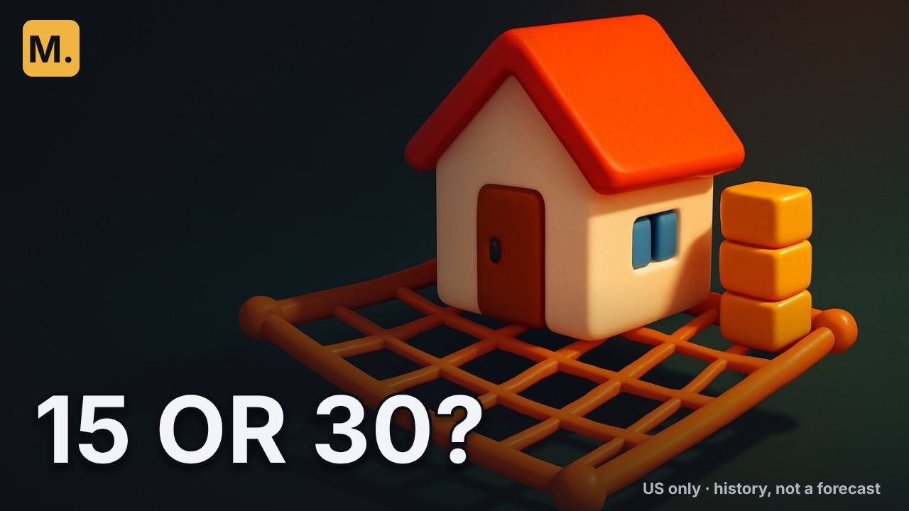</a> |  |  | 7.5: lưới an toàn | ĐẠT: "15 OR 30?" · chữ 12.4 px · 14.38:1 · nền `ep007-b` · như trên |

## Tập 6 · annuity — `dn6-0g2RvD0` · T1: Annuity With a 2% Raise: It Kept Up in 17 of 715 Stretches

| TC | cỡ thật (bấm mở) | điện thoại 360 px | 168×94 | điểm Claude | kiểm máy · nền · claim |
|---|---|---|---|---|---|
| **#1** | <a href="final/ep006-tc1.jpg">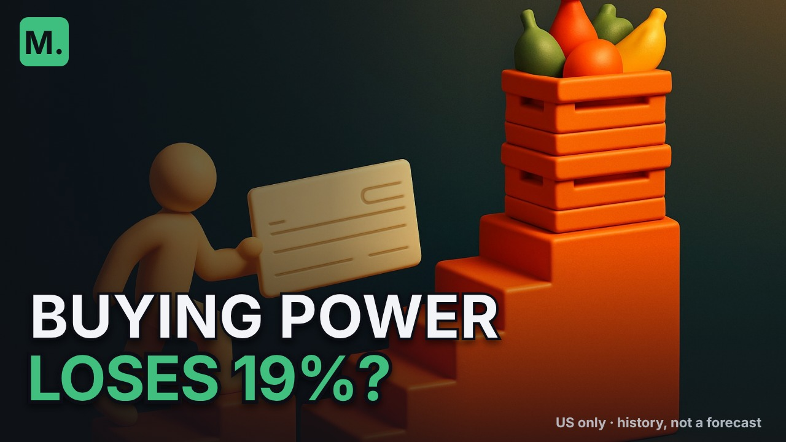</a> |  |  | 8: khung mất mát rõ; séc leo bậc thấp hơn thùng hàng | ĐẠT: "BUYING POWER LOSES 19%?" · chữ 9.2/9.5 px · 9.28 / 5.92:1 · nền `ep006-c` · 100 − 80.7 (median_real_value_2pct_payment_after_20y_pct) = 19.3 % sức mua mất ở mốc 20 năm, trung vị 715 giai đoạn; điều kiện ở dòng 1 mô tả |
| **#2** | <a href="final/ep006-tc2.jpg">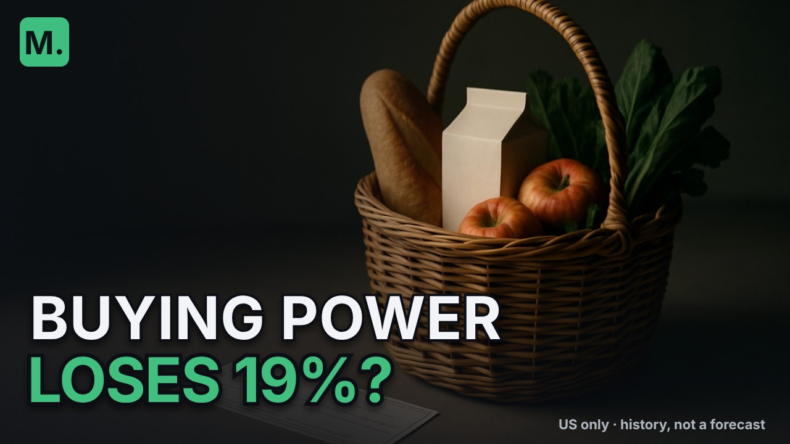</a> |  |  | 7.5: nền nghiêm/thực tế cho khán giả lớn tuổi; tấm séc bị chữ che — giỏ hàng là chủ thể | ĐẠT: "BUYING POWER LOSES 19%?" · chữ 9.2/9.5 px · 10.71 / 5.22:1 · nền `ep006-g` · như trên — nền nghiêm/thực tế (séc + giỏ hàng, không người) |
| **#3** |  |  |  | 7.5: bản cũ — giữ để đo | ĐẠT: "STILL BUYS 80.7%" · chữ 9.2/14.3 px · 6.58 / 6.48:1 · nền `ep006-c` · bản cũ — giữ để đo |

---

# Tờ duyệt ảnh bìa R1-AI (D-015)

Mỗi video: **chọn 1 ảnh mặc định**; 3 ảnh vào **Test & Compare** (đề nghị: #1, #2, #3; đổi #3 lấy đối chứng mã #0 nếu muốn thử AI vs mã). Tiêu đề = **T1 đã duyệt 17/10**. Phần hình #1–#3: OpenAI `gpt-image-1` (không chữ, `RIGHTS.md` §H); chữ, số, logo: ghép bằng mã. Điểm /10 = Claude chấm bằng mắt ở 360 px và 168×94 (rõ chủ thể 4 + khớp video 4 + chữ không đè chủ thể 2). Kiểm máy 168×94: chữ hoa ≥ 9 px, tương phản ≥ 4,5:1 (chữ trắng / chữ màu trụ). Tập 3: giữ nguyên làm đối chứng tới 01/11 — không có ở tờ này.

Loại (3/video) và lý do: `ai/selection.json`; cả 42 nền: `ai/raw/`.

## Tập 5 · PMI — `1o-2RJ-DdfE`

**T1:** When Does PMI Go Away With 10% Down? 8 Years by Schedule (56 ký tự)

| # | cỡ thật (bấm mở 1280×720) | điện thoại 360 px | 168×94 | điểm Claude | kiểm máy |
|---|---|---|---|---|---|
| **#1** |  |  |  | 9: nhà trong khiên bảo hiểm + đồng hồ cát: 'bảo hiểm kéo dài bao lâu' — đúng câu hỏi tập | ĐẠT: chữ 9.2/9.7 px · 11.52:1 / 7.26:1 · "ON PAPER? 23 MONTHS" |
| **#2** |  |  |  | 9: nhà trong đồng hồ cát: thời gian, rất rõ ở 168 px | ĐẠT: chữ 9.2/9.7 px · 17.02:1 / 9.92:1 · "ON PAPER? 23 MONTHS" |
| **#3** |  |  |  | 7.5: cột giá trị nhà vs cột nợ + vạch: đúng hình 'loan vs value' của phim, kém rõ ở 168 px | ĐẠT: chữ 9.2/9.7 px · 13.38:1 / 9.45:1 · "ON PAPER? 23 MONTHS" |
| **#0** mã | <a href="final/ep005-0-maA.jpg">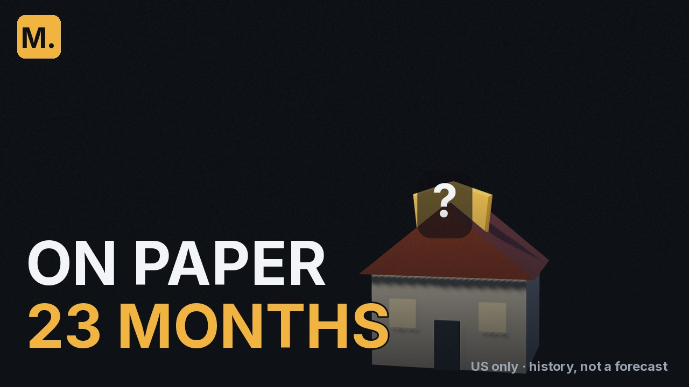</a> |  |  | —: đối chứng dựng bằng mã R1 (ep005-A, khung phim) | ĐẠT: chữ 10.7 px · 17.16:1 / 10.25:1 · "ON PAPER / 23 MONTHS" |

## Tập 8 · rent vs buy — `26SfSIDPpzk`

**T1:** Is Renting a Waste of Money? Buying Led in 3 of 4 Months (56 ký tự)

| # | cỡ thật (bấm mở 1280×720) | điện thoại 360 px | 168×94 | điểm Claude | kiểm máy |
|---|---|---|---|---|---|
| **#1** |  |  | 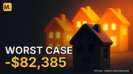 | 9: một nhà tối trước dãy nhà sáng = 'darkest house' 6/2006 của phim, khớp chữ WORST CASE | ĐẠT: chữ 9.2/12.6 px · 5.82:1 / 8.45:1 · "WORST CASE -$82,385" |
| **#2** | <a href="final/ep008-2-aia.jpg">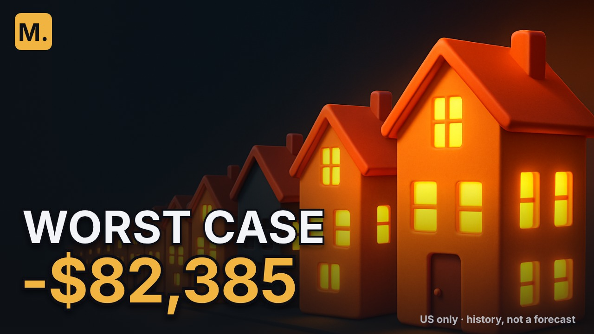</a> |  |  | 8: phố nhà sáng có đoạn tối = phố 307 tháng của phim | ĐẠT: chữ 9.2/12.6 px · 7.96:1 / 8.16:1 · "WORST CASE -$82,385" |
| **#3** | <a href="final/ep008-3-aic.jpg">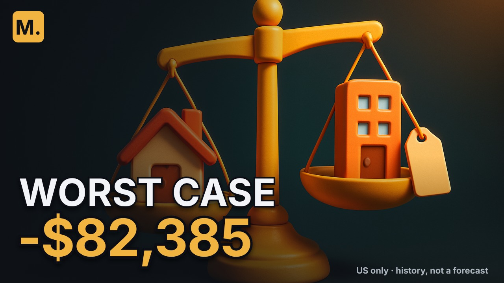</a> |  |  | 7.5: cân nhà vs căn hộ có thẻ thuê: đúng đề tài, không gắn số | ĐẠT: chữ 9.2/12.6 px · 7.03:1 / 8.19:1 · "WORST CASE -$82,385" |
| **#0** mã |  |  | 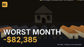 | —: đối chứng dựng bằng mã R1 (ep008-A, khung phim) | ĐẠT: chữ 10.7 px · 12.64:1 / 7.55:1 · "WORST MONTH / -$82,385" |

## Tập 9 · rent & invest (sắp đăng) — `(chưa đăng)`

**T1:** Rent and Invest vs Buy: Renter Ahead in 155 of 307 Months (57 ký tự)

| # | cỡ thật (bấm mở 1280×720) | điện thoại 360 px | 168×94 | điểm Claude | kiểm máy |
|---|---|---|---|---|---|
| **#1** |  |  |  | 9: đồng xu tung (nhà / mũi tên lên) = câu kết 'a coin flip', khớp COIN FLIP? | ĐẠT: chữ 9.2/14.3 px · 16.36:1 / 9.83:1 · "COIN FLIP? 49.5%" |
| **#2** |  |  |  | 8.5: bập bênh nhà vs tháp khối xanh cân bằng = 'about half' | ĐẠT: chữ 9.2/14.3 px · 8.04:1 / 7.19:1 · "COIN FLIP? 49.5%" |
| **#3** | <a href="final/ep009-3-aif.jpg">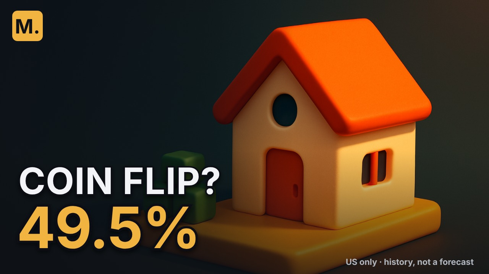</a> |  |  | 7.5: nhà trên đế rộng vs đống khối đế nhỏ = 'bigger base' (6:36) | ĐẠT: chữ 9.2/14.3 px · 15.16:1 / 8.98:1 · "COIN FLIP? 49.5%" |
| **#0** mã | <a href="final/ep009-0-maC.jpg">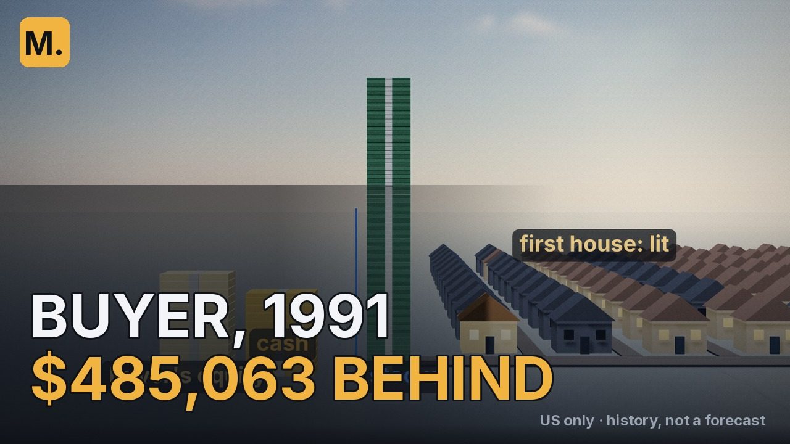</a> |  | 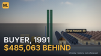 | —: đối chứng dựng bằng mã R1 (ep009-C, khung phim) | ĐẠT: chữ 9.2 px · 8.21:1 / 4.9:1 · "BUYER, 1991 / $485,063 BEHIND" |

## Tập 1 · refi — `OEVfD-ywzLc`

**T1:** Should I Refinance? A $115,000 Loan Needed a 1.12-Point Cut (59 ký tự)

| # | cỡ thật (bấm mở 1280×720) | điện thoại 360 px | 168×94 | điểm Claude | kiểm máy |
|---|---|---|---|---|---|
| **#1** |  |  |  | 8.5: đồng hồ cạnh nhà = 'break-even month', rõ ở 168 px | ĐẠT: chữ 9.2/10.9 px · 8.29:1 / 10.2:1 · "FEES BACK? MONTH 30" |
| **#2** |  |  |  | 8: phong bì + thư = 'a letter comes from her lender' (0:33) | ĐẠT: chữ 9.2/10.9 px · 6.02:1 / 5.96:1 · "FEES BACK? MONTH 30" |
| **#3** |  |  |  | 8: cân: túi phí nặng hơn đống xu tiết kiệm = phép so phí vs tiết kiệm | ĐẠT: chữ 9.2/10.9 px · 12.91:1 / 9.49:1 · "FEES BACK? MONTH 30" |
| **#0** mã | <a href="final/ep001-0-maA.jpg">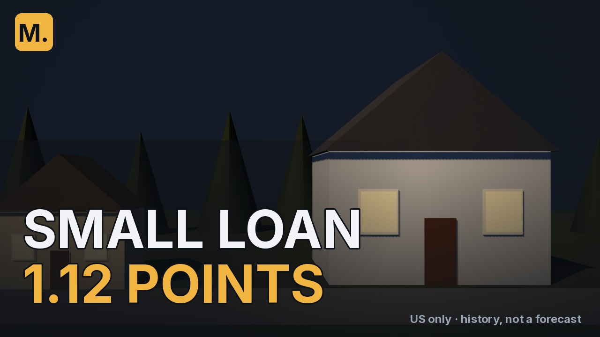</a> |  |  | —: đối chứng dựng bằng mã R1 (ep001-A, khung phim) | ĐẠT: chữ 10.7 px · 8.49:1 / 5.07:1 · "SMALL LOAN / 1.12 POINTS" |

## Tập 2 · vay học — `-AwfRUE6UTI`

**T1:** Private Student Loans: Fixed or Variable? Since 1954 (52 ký tự)

| # | cỡ thật (bấm mở 1280×720) | điện thoại 360 px | 168×94 | điểm Claude | kiểm máy |
|---|---|---|---|---|---|
| **#1** |  |  |  | 8.5: tàu lượn lên đỉnh mang mũ tốt nghiệp = đỉnh lãi 1977, khớp WORST CASE | ĐẠT: chữ 9.2/14.3 px · 14.53:1 / 9.66:1 · "WORST CASE +43%" |
| **#2** |  |  |  | 8: mũ + sách + biểu đồ một đỉnh nhọn | ĐẠT: chữ 9.2/14.3 px · 9.79:1 / 9.59:1 · "WORST CASE +43%" |
| **#3** |  |  |  | 7.5: ngã ba đường thẳng (cố định) / đường lượn (thả nổi) | ĐẠT: chữ 9.2/14.3 px · 5.41:1 / 9.45:1 · "WORST CASE +43%" |
| **#0** mã | <a href="final/ep002-0-maA.jpg">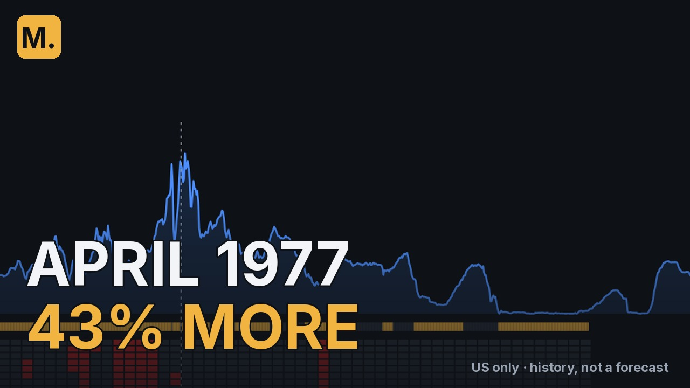</a> |  |  | —: đối chứng dựng bằng mã R1 (ep002-A, khung phim) | ĐẠT: chữ 10.7 px · 10.64:1 / 6.35:1 · "APRIL 1977 / 43% MORE" |

## Tập 6 · annuity — `dn6-0g2RvD0`

**T1:** Annuity With a 2% Raise: It Kept Up in 17 of 715 Stretches (58 ký tự)

| # | cỡ thật (bấm mở 1280×720) | điện thoại 360 px | 168×94 | điểm Claude | kiểm máy |
|---|---|---|---|---|---|
| **#1** |  |  |  | 8: séc leo bậc thấp, thùng hàng leo bậc cao = giá tăng nhanh hơn khoản tăng 2 % | ĐẠT: chữ 9.2/14.3 px · 6.58:1 / 6.48:1 · "STILL BUYS 80.7%" |
| **#2** |  |  |  | 7: hình nhân + hàng thùng + séc: đúng hình 'crates' của phim, hình nhân hơi giống người thật → kiểm lại | ĐẠT: chữ 9.2/14.3 px · 9.73:1 / 5.88:1 · "STILL BUYS 80.7%" |
| **#3** |  |  |  | 6.5: hình nhân cao tuổi + thùng: rõ đề tài hưu trí, ít ý so sánh | ĐẠT: chữ 9.2/14.3 px · 9.15:1 / 5.89:1 · "STILL BUYS 80.7%" |
| **#0** mã | <a href="final/ep006-0-maA.jpg">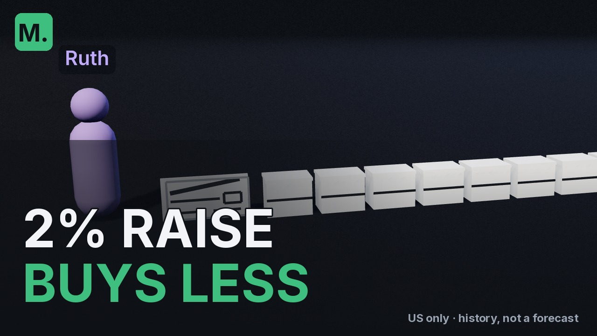</a> |  |  | —: đối chứng dựng bằng mã R1 (ep006-A, khung phim) | ĐẠT: chữ 10.7 px · 11.15:1 / 5.25:1 · "2% RAISE / BUYS LESS" |

## Tập 7 · 15 vs 30 — `p78Ca1OHTgM`

**T1:** 15 Year vs 30 Year Mortgage Paid in 15: $120 a Month More (57 ký tự)

| # | cỡ thật (bấm mở 1280×720) | điện thoại 360 px | 168×94 | điểm Claude | kiểm máy |
|---|---|---|---|---|---|
| **#1** | <a href="final/ep007-1-aia.jpg">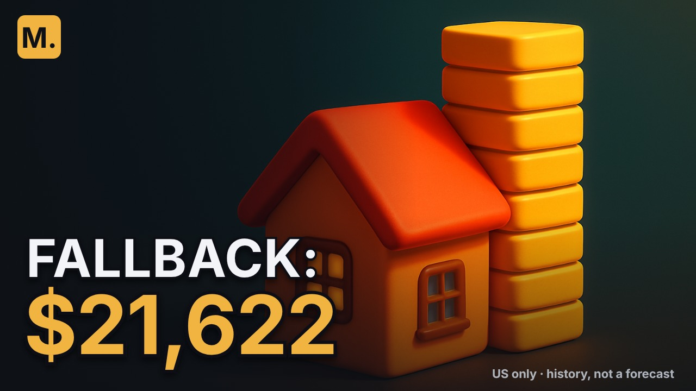</a> |  |  | 8.5: nhà + chồng vàng cao = 'the stack' của phim | ĐẠT: chữ 9.2/14.3 px · 14.8:1 / 9.27:1 · "FALLBACK: $21,622" |
| **#2** | <a href="final/ep007-2-aid.jpg">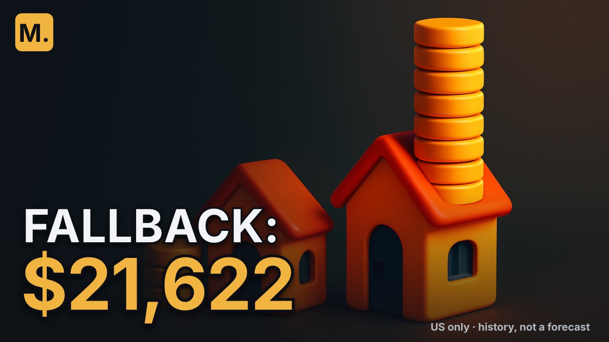</a> |  |  | 8: hai nhà, chồng mỏng vs chồng cao = Leo vs Tessa | ĐẠT: chữ 9.2/14.3 px · 14.02:1 / 7.69:1 · "FALLBACK: $21,622" |
| **#3** | <a href="final/ep007-3-aib.jpg">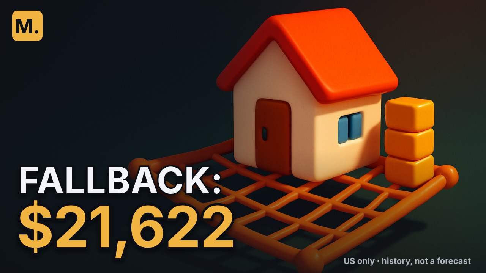</a> |  |  | 7.5: nhà trên lưới an toàn = 'fallback' (khoản dự phòng) | ĐẠT: chữ 9.2/14.3 px · 11.14:1 / 9.55:1 · "FALLBACK: $21,622" |
| **#0** mã | <a href="final/ep007-0-maC.jpg">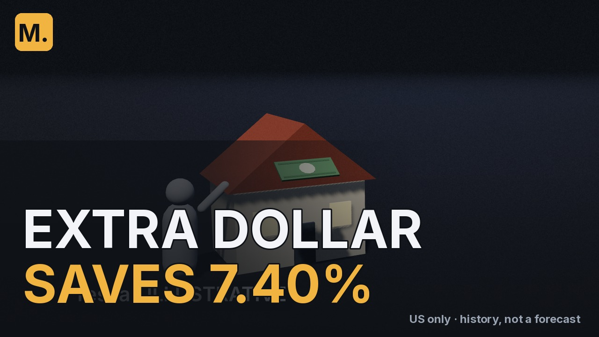</a> |  | 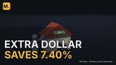 | —: đối chứng dựng bằng mã R1 (ep007-C, khung phim) | ĐẠT: chữ 10.7 px · 9.01:1 / 5.38:1 · "EXTRA DOLLAR / SAVES 7.40%" |
