# Tờ duyệt đóng gói R1

Chọn mỗi tập **1 tiêu đề (T1–T3) + 1 ảnh mặc định (A–C)**; hai ảnh còn lại vào Test & Compare. Thứ tự tiêu đề = xếp hạng đề nghị (lý do: `R1.md` §1). Ảnh: bấm để mở cỡ thật 1280×720. Kiểm máy ở 168×94: chữ hoa ≥ 9 px và tương phản WCAG ≥ 4,5:1 (chữ trắng và chữ màu trụ, so với nền sáng nhất 10 % sau chữ).

## Tập 1 · refi — `OEVfD-ywzLc`

Hiện tại: *Why a Smaller Loan Needs a Bigger Rate Cut to Be Worth It*

- **T1** (59 ký tự): Should I Refinance? A $115,000 Loan Needed a 1.12-Point Cut
- **T2** (58 ký tự): Is Refinancing Worth It? Your Loan Size Changes the Answer
- **T3** (55 ký tự): Refinance Break-Even: Why Small Loans Need Over 1 Point

| | cỡ thật (thu nhỏ để xem, bấm mở 1280×720) | điện thoại 360 px | 168×94 | kiểm máy |
|---|---|---|---|---|
| **A** · SMALL LOAN / 1.12 POINTS |  |  |  | ĐẠT: chữ 10.7 px · 8.49:1 / 5.07:1 |
| **B** · FEES BACK / MONTH 30 |  |  |  | ĐẠT: chữ 10.7 px · 7.57:1 / 4.52:1 |
| **C** · 1-POINT RULE / FITS NONE |  |  |  | ĐẠT: chữ 10.7 px · 8.42:1 / 5.03:1 |

## Tập 2 · vay học — `-AwfRUE6UTI`

Hiện tại: *Need Private Grad Loans? Variable vs Fixed Through History*

- **T1** (52 ký tự): Private Student Loans: Fixed or Variable? Since 1954
- **T2** (56 ký tự): Fixed or Variable Student Loan? Worst Case Cost 43% More
- **T3** (54 ký tự): Variable vs Fixed Student Loan: Cost More 1 in 7 Times

| | cỡ thật (thu nhỏ để xem, bấm mở 1280×720) | điện thoại 360 px | 168×94 | kiểm máy |
|---|---|---|---|---|
| **A** · APRIL 1977 / 43% MORE | <a href="ep002-A.png">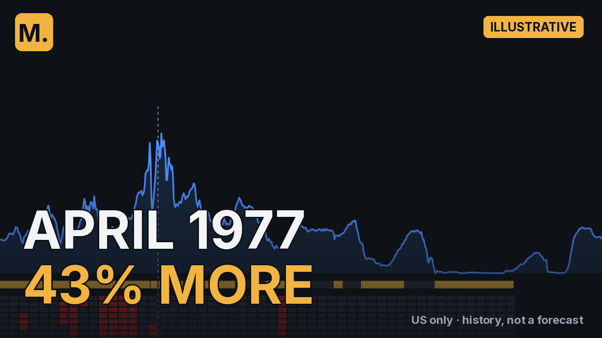</a> |  | 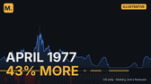 | ĐẠT: chữ 10.7 px · 10.64:1 / 6.35:1 |
| **B** · COSTLIER / 1 IN 7 | <a href="ep002-B.png">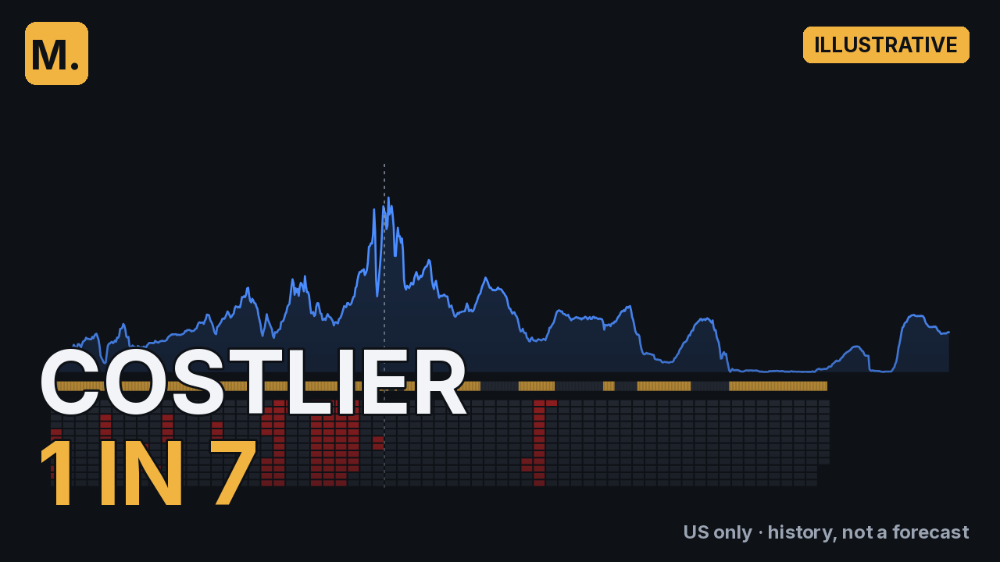</a> |  | 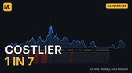 | ĐẠT: chữ 10.7 px · 11.76:1 / 7.02:1 |
| **C** · HEAD START / 2 POINTS? |  |  |  | ĐẠT: chữ 10.7 px · 11.64:1 / 6.95:1 |

## Tập 3 · EE vs T-bill — `2ErffZBHggE`

Hiện tại: *EE Bonds vs T-Bills: Can Rolling Beat Double in 20 Years?*

- **T1** (59 ký tự): EE Bonds vs T-Bills: Rolling Beat Double Only Half the Time
- **T2** (57 ký tự): EE Bonds Explained: Does Double in 20 Years Beat T-Bills?
- **T3** (58 ký tự): Savings Bonds vs T-Bills: Since 1990, Rolls Beat Double 5%

| | cỡ thật (thu nhỏ để xem, bấm mở 1280×720) | điện thoại 360 px | 168×94 | kiểm máy |
|---|---|---|---|---|
| **A** · BEAT DOUBLE / 52.3% |  |  |  | ĐẠT: chữ 10.7 px · 11.0:1 / 5.18:1 |
| **B** · SINCE 1990 / ONLY 5% | <a href="ep003-B.png">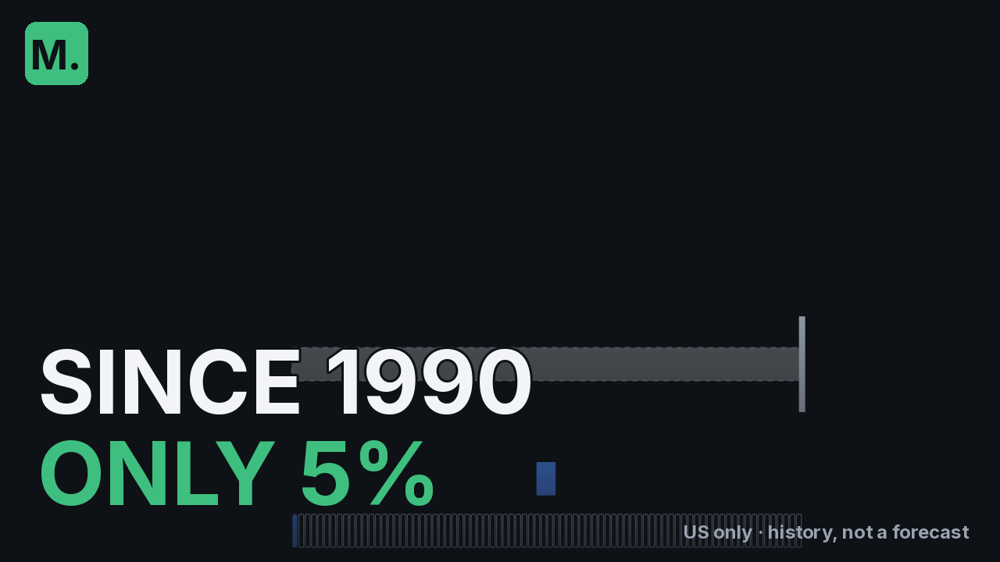</a> |  | 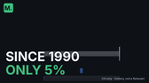 | ĐẠT: chữ 10.7 px · 17.03:1 / 8.01:1 |
| **C** · THE LINE / 3.47% | <a href="ep003-C.png">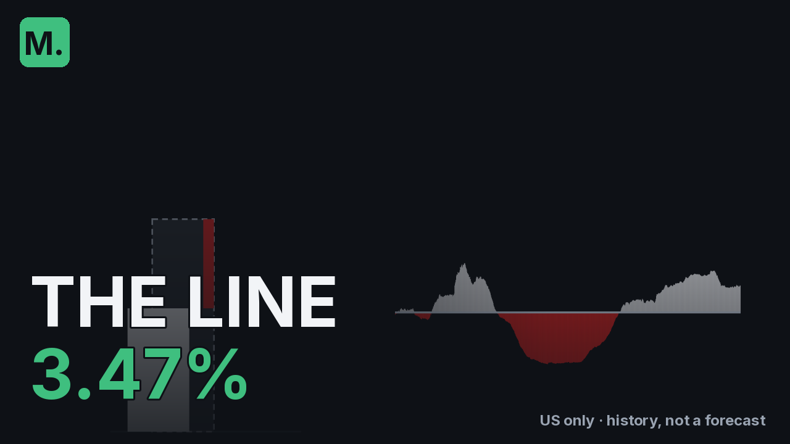</a> |  |  | ĐẠT: chữ 10.7 px · 10.05:1 / 4.73:1 |

## Tập 5 · PMI — `1o-2RJ-DdfE`

Hiện tại: *10% Down: When Does PMI Actually End?*

- **T1** (56 ký tự): When Does PMI Go Away With 10% Down? 8 Years by Schedule
- **T2** (51 ký tự): When Does PMI Go Away? 10% Down: 23 Months on Paper
- **T3** (57 ký tự): PMI With 10% Down: How Long It Lasted, 1991-2016 Replayed

| | cỡ thật (thu nhỏ để xem, bấm mở 1280×720) | điện thoại 360 px | 168×94 | kiểm máy |
|---|---|---|---|---|
| **A** · ON PAPER / 23 MONTHS | <a href="ep005-A.png">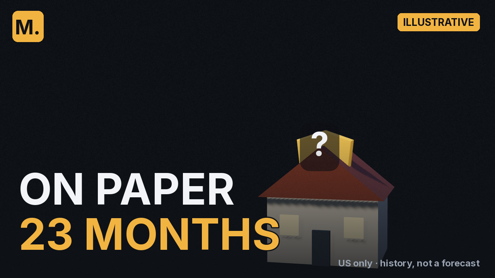</a> |  |  | ĐẠT: chữ 10.7 px · 17.16:1 / 10.25:1 |
| **B** · SLOWEST / 112 MONTHS |  |  |  | ĐẠT: chữ 10.7 px · 9.01:1 / 5.38:1 |
| **C** · BY SCHEDULE / 8 YEARS |  |  |  | ĐẠT: chữ 10.7 px · 7.78:1 / 4.65:1 |

## Tập 6 · annuity — `dn6-0g2RvD0`

Hiện tại: *Can a 2% Annuity Raise Keep Up With Inflation?*

- **T1** (58 ký tự): Annuity With a 2% Raise: It Kept Up in 17 of 715 Stretches
- **T2** (53 ký tự): Annuity Inflation Protection: Did a 2% Raise Keep Up?
- **T3** (58 ký tự): Does a 2% Annuity Raise Keep Up? It Kept 80.7% at 20 Years

| | cỡ thật (thu nhỏ để xem, bấm mở 1280×720) | điện thoại 360 px | 168×94 | kiểm máy |
|---|---|---|---|---|
| **A** · 2% RAISE / BUYS LESS | <a href="ep006-A.png">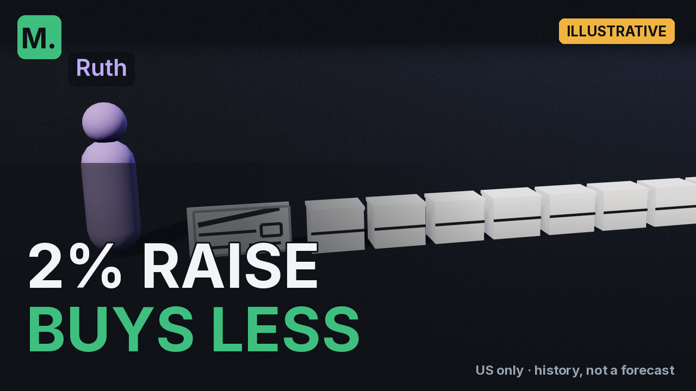</a> |  |  | ĐẠT: chữ 10.7 px · 11.15:1 / 5.25:1 |
| **B** · KEPT UP / 17/715 | <a href="ep006-B.png">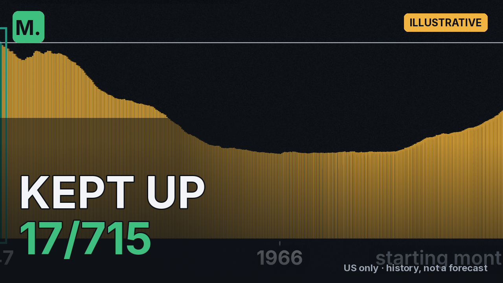</a> |  | 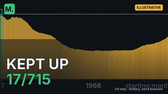 | ĐẠT: chữ 10.7 px · 9.59:1 / 4.51:1 |
| **C** · WORST START / 43.1% LEFT | <a href="ep006-C.png">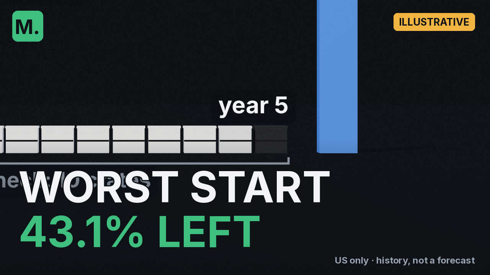</a> |  | 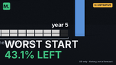 | ĐẠT: chữ 10.7 px · 13.07:1 / 6.15:1 |

## Tập 7 · 15 vs 30 — `p78Ca1OHTgM`

Hiện tại: *15-Year Mortgage vs. 30-Year Paid in 15: The Real Cost*

- **T1** (57 ký tự): 15 Year vs 30 Year Mortgage Paid in 15: $120 a Month More
- **T2** (58 ký tự): Pay Off 30 Year Mortgage in 15? Costs $21,622 vs a 15-Year
- **T3** (55 ký tự): 15 vs 30 Year Mortgage: Every Week Since 1991, Replayed

| | cỡ thật (thu nhỏ để xem, bấm mở 1280×720) | điện thoại 360 px | 168×94 | kiểm máy |
|---|---|---|---|---|
| **A** · THE FALLBACK / $21,622 | <a href="ep007-A.png">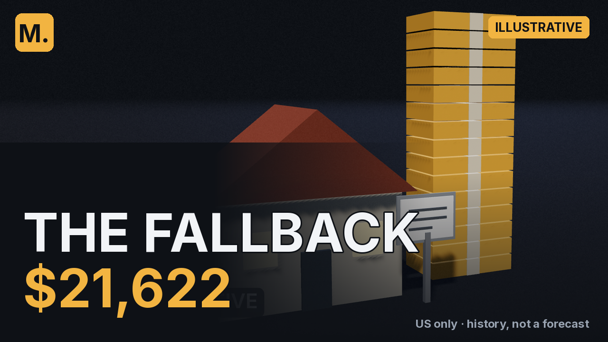</a> |  |  | **TRƯỢT**: chữ 10.7 px · 7.53:1 / 4.49:1 |
| **B** · PRICIEST / 1/5 OF WEEKS | <a href="ep007-B.png">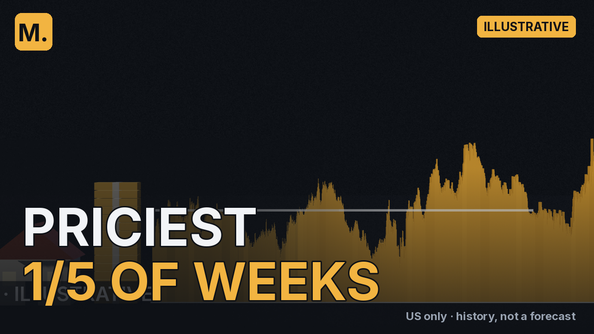</a> |  |  | ĐẠT: chữ 10.7 px · 8.39:1 / 5.01:1 |
| **C** · EXTRA DOLLAR / SAVES 7.40% | <a href="ep007-C.png">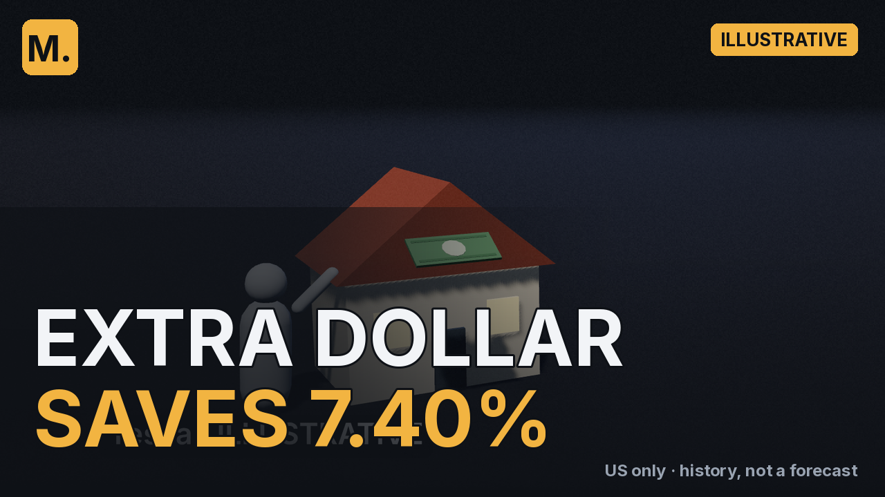</a> |  |  | ĐẠT: chữ 10.7 px · 9.01:1 / 5.38:1 |

## Tập 8 · rent vs buy — `26SfSIDPpzk`

Hiện tại: *Is Rent Really Wasted? Buying vs. Renting for 10 Years*

- **T1** (56 ký tự): Is Renting a Waste of Money? Buying Led in 3 of 4 Months
- **T2** (57 ký tự): Renting vs Buying a Home: 307 Start Months, 10 Years Each
- **T3** (45 ký tự): Rent vs Buy: Every Month Since 1991, Replayed

| | cỡ thật (thu nhỏ để xem, bấm mở 1280×720) | điện thoại 360 px | 168×94 | kiểm máy |
|---|---|---|---|---|
| **A** · WORST MONTH / -$82,385 | <a href="ep008-A.png">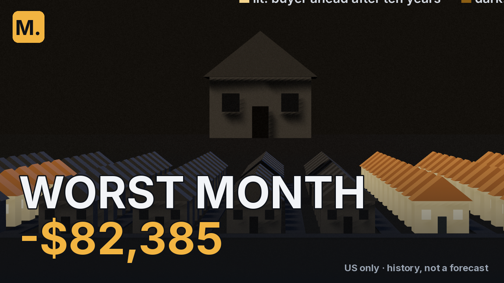</a> |  |  | ĐẠT: chữ 10.7 px · 12.64:1 / 7.55:1 |
| **B** · DARK STRETCH / 6/72 LIT | <a href="ep008-B.png">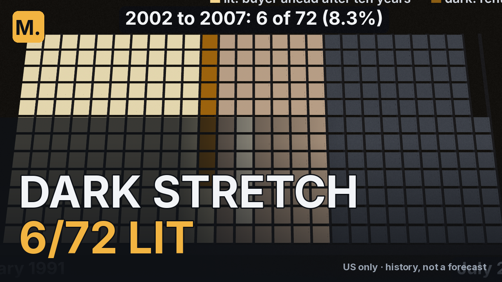</a> |  |  | ĐẠT: chữ 10.7 px · 8.0:1 / 4.78:1 |
| **C** · HELD 15 YEARS / 100% | <a href="ep008-C.png">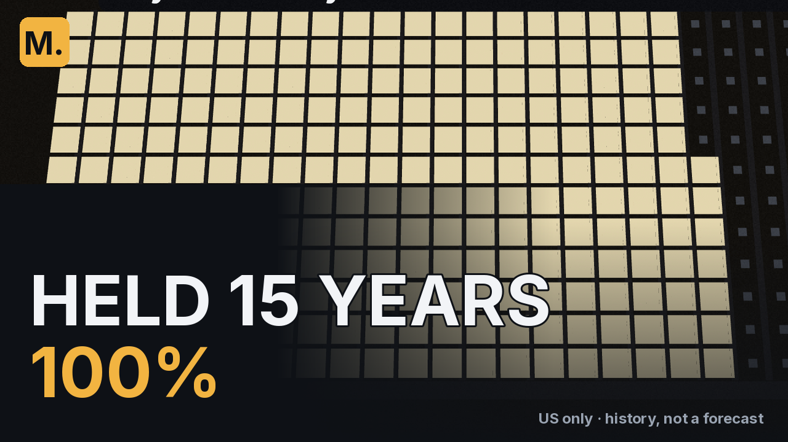</a> |  |  | **TRƯỢT**: chữ 10.7 px · 5.62:1 / 3.36:1 |

## Tập 9 · rent & invest (sắp đăng) — `(chưa đăng)`

Hiện tại: *G1 T1: Rent and Invest the Difference? We Replayed Every Start Month Since 1991 (71 ký tự)*

- **T1** (57 ký tự): Rent and Invest vs Buy: Renter Ahead in 155 of 307 Months
- **T2** (57 ký tự): Rent and Invest the Difference? 307 Start Months Replayed
- **T3** (56 ký tự): Buying a Home vs Renting and Investing: 50/50 Since 1991

| | cỡ thật (thu nhỏ để xem, bấm mở 1280×720) | điện thoại 360 px | 168×94 | kiểm máy |
|---|---|---|---|---|
| **A** · 15 YEARS / BUYER 21.9% | <a href="ep009-A.png">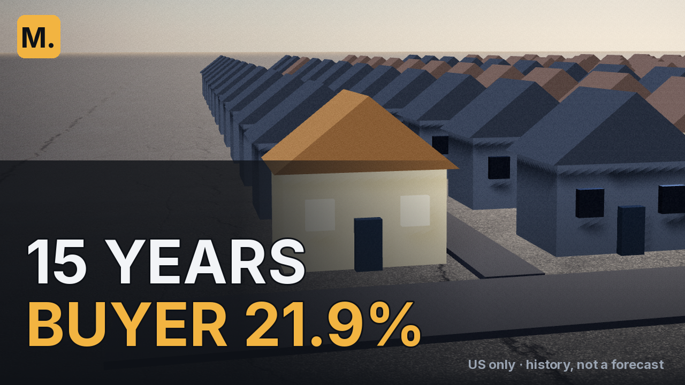</a> |  |  | ĐẠT: chữ 10.7 px · 8.2:1 / 4.89:1 |
| **B** · HOUSE AHEAD / 49.5% | <a href="ep009-B.png">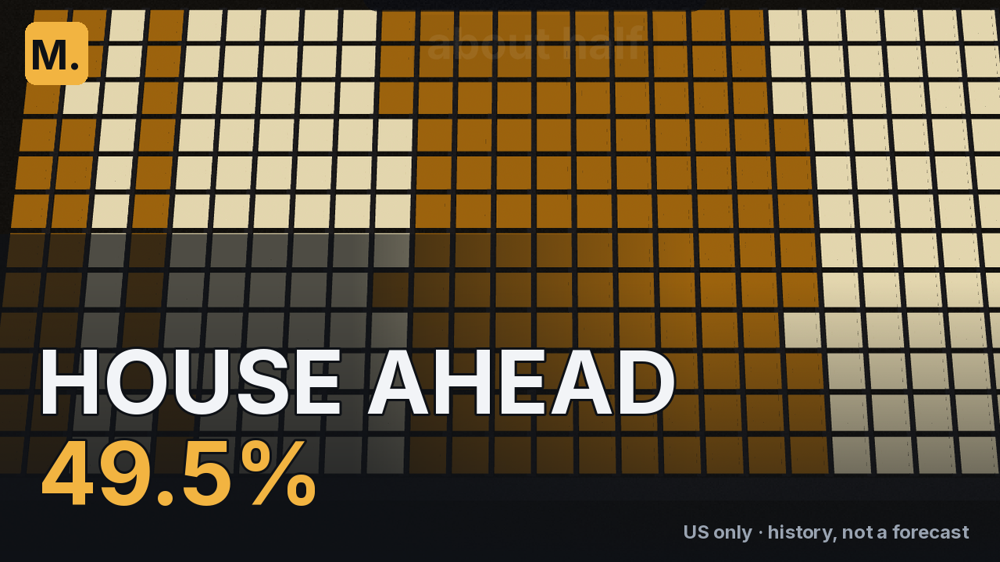</a> |  |  | ĐẠT: chữ 10.7 px · 9.21:1 / 5.5:1 |
| **C** · BUYER, 1991 / $485,063 BEHIND | <a href="ep009-C.png">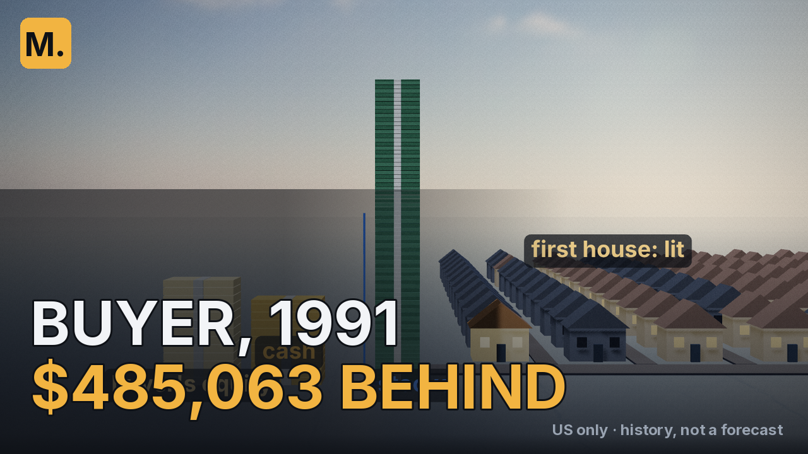</a> |  |  | ĐẠT: chữ 9.2 px · 8.21:1 / 4.9:1 |
